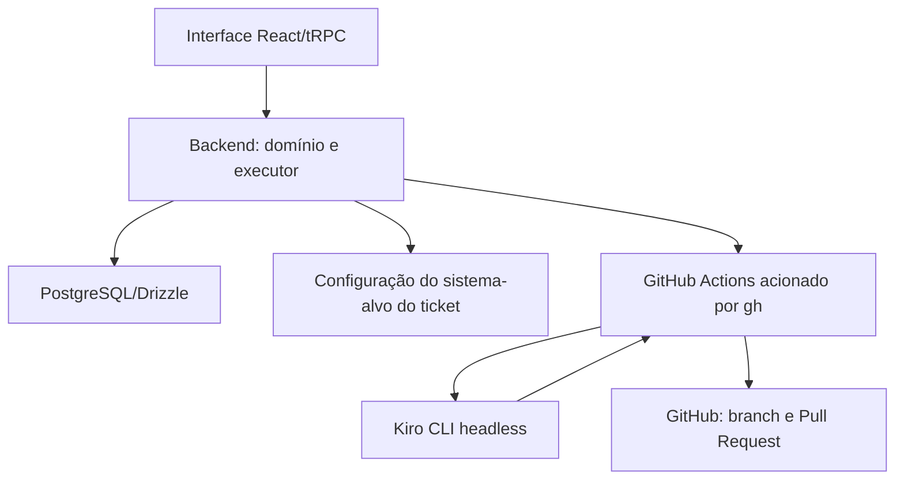

# Resolva — design do MVP

## Objetivo e limites

O sistema terá um frontend próprio, um backend local e PostgreSQL em Docker. O backend coordena tickets, a configuração do sistema-alvo, triagens, execuções e evidências. Cada ticket seleciona a configuração validada do sistema-alvo. Após o início manual, o backend usa o executável local `gh` para disparar o workflow do GitHub Actions; o workflow executa o Kiro CLI em modo headless, valida a alteração e abre uma Pull Request.

A primeira demonstração usa a configuração que aponta para `examples/demo-target`, um bug conhecido de cálculo em centavos e um teste de regressão executável. O projeto alvo deve permanecer separado da aplicação Resolva.

## Arquitetura



Organização prevista:

```text
backend/src/
  config/             ambiente e resolva.config.json
  db/                 conexão, schema e migrações
  domain/             estados, validações e contratos
  repository/         transações e consultas
  services/           tickets e coordenação
  trpc/routers/       tickets, execuções e ambiente
  executor/           fases, limites, chamadas ao gh e evidências
  integrations/github/ workflow dispatch, branch, commit, Pull Request e reconciliação
  integrations/kiro/  prompts, relatórios e eventos do Kiro
web/src/
  components/         layout e componentes reutilizáveis
  routes/              tickets, execuções e configuração
  trpc.ts             cliente tipado
examples/demo-target/ fixture independente do piloto
config/               exemplo sem credenciais
```

O frontend importa somente `AppRouter` e tipos públicos. Não importa banco, executor ou configuração secreta.

## Domínio e persistência

Estados de ticket: `aberto`, `em_triagem`, `recusado`, `aguardando_informacoes`, `aguardando_implementacao`, `em_andamento`, `aguardando_revisao`, `resolvido`.

Classificações de triagem: `falso_positivo`, `entendimento_incorreto`, `bug`, `melhoria`, `inconclusivo`. A classificação vigente não substitui o estado do ticket nem o resultado da execução.

Estados de execução: `em_andamento`, `bloqueada`, `falhou`, `concluida`, `interrompida`. Cada execução possui `kind: triage | implementation`.

Etapas de triagem: `preparando_contexto`, `analisando_ticket`, `consolidando_triagem`.

Etapas de implementação: `preparando_ambiente`, `reproduzindo_problema`, `implementando_correcao`, `validando`, `publicando_pr`.

Tabelas:

- `config/resolva.config.json`: configuração única do sistema-alvo, sem credenciais no arquivo versionado.
- `tickets`: relato, comportamento esperado, categoria, `targetSystemKey`, snapshot/version da configuração selecionada, status, versão otimista, classificação vigente e datas.
- `triages`: execução, versão do ticket, snapshot do relato e da configuração, classificação, justificativa, comportamento observado, regra esperada, fontes, incertezas, próxima ação, hashes de contexto e validade.
- `ticket_events`: histórico imutável de estados, triagens, mensagens, complementações, contestações e decisões de implementação.
- `deliveries`: agrupamento da implementação, branch, SHA e Pull Request.
- `executions`: tipo `triage|implementation`, workflow, snapshots sem segredo, estado, diagnóstico, rodada, SHAs e versão do Kiro.
- `execution_events`: eventos públicos ordenados por sequência.
- `artifacts`: referências a logs filtrados, diffs e resultados de testes.

Usar UUID para entidades internas, número inteiro para ticket e identificador visual `RES-001`. Usar `timestamptz` no banco e ISO 8601 UTC na API. Não excluir tickets nem históricos. Usar transação e índice único parcial para garantir uma execução ativa globalmente.

O ticket armazena a chave da configuração e um snapshot imutável da versão usada pela triagem e pela implementação. Alterar a configuração não reescreve tickets existentes; tickets com snapshot incompatível ficam inelegíveis até nova triagem. O usuário escolhe a configuração disponível, mas não fornece comandos, caminhos, credenciais ou modelo em texto livre.

## Contratos de API

Todos os inputs e outputs são schemas Zod sem campos extras silenciosos. A API usa tRPC, com `GET /rest/health` apenas para healthcheck.

Procedures mínimas:

- `tickets.create`, `tickets.list`, `tickets.byId`, `tickets.update`, `tickets.events`.
- `tickets.provideInformation`, `tickets.contestTriage`, `tickets.requestChanges`, `tickets.resolve`, `tickets.reopen`.
- `triages.start`, `triages.list`, `triages.byId`, `triages.events`, `triages.artifact`.
- `implementations.queue`, `implementations.start`, `implementations.list`, `implementations.byId`.
- `executions.list`, `executions.byId`, `executions.events`, `executions.artifact`.
- `environment.get`, `environment.check`.

Erros públicos: `BAD_REQUEST`, `NOT_FOUND`, `CONFLICT`, `PRECONDITION_FAILED` e `INTERNAL_SERVER_ERROR`. Nunca devolver stack trace, credenciais ou saída bruta não filtrada.

## Configuração segura

O arquivo `resolva.config.json` fica ignorado pelo Git. Versionar apenas `config/resolva.config.example.json`. O MVP mantém uma única configuração de sistema-alvo por instalação; o ticket seleciona essa configuração por uma chave validada.

A configuração valida com Zod:

- identificador do sistema e nome exibido;
- projeto, repositório GitHub, branch base e referência da workflow;
- `allowedPaths`, `testPaths` e `documentationPaths` relativos à raiz;
- comandos de preparação e validação fixados pelo operador;
- adaptador de testes e modelo Kiro;
- limites de rodadas, tempo e tamanho do diff;
- URL e autenticação necessárias para disparar a workflow, mantidas fora do snapshot.

Recusar caminhos absolutos, `..`, symlinks que escapem da raiz, glob global e comandos derivados do ticket. O ticket não fornece comandos, caminhos, credenciais ou modelo em texto livre. A execução recebe apenas um snapshot operacional sem segredos.

O backend valida a configuração antes de reservar a implementação e registra `workflowId`/URL após o disparo. A workflow revalida o checkout e os limites antes de alterar o sistema-alvo.

## Executor e Kiro

O backend mantém uma execução ativa global, grava a reserva e dispara uma única `gh` local configurada. A workflow faz checkout do sistema-alvo, executa os comandos permitidos, invoca o Kiro CLI headless, valida o resultado e cria a Pull Request. O backend não precisa executar o Kiro diretamente no mesmo processo.

A triagem usa contexto somente leitura e não cria branch, commit ou PR. A implementação recebe o snapshot do ticket e da configuração. O backend envia à workflow apenas dados necessários, sem credenciais ou ambiente completo.

A workflow deve executar o comando headless configurado, equivalente a:

```text
kiro-cli chat --v3 --no-interactive --output-format stream-json --model <modelo>
```

O resultado deve ser um relatório JSON validado, associado ao `executionId`. A workflow informa ao backend `workflowId`, status, branch, SHA, PR e motivo de falha por callback. O callback é idempotente; uma consulta de reconciliação pode ser acionada manualmente quando a resposta for perdida.

O relatório da implementação exige identidade da execução, escopo, critérios de aceite, referências e dados de teste apropriados ao tipo `bug` ou `melhoria`. Saída textual do Kiro ou status isolado da workflow não comprova sucesso.

## Triagem, elegibilidade e implementação

1. Registrar ticket em `aberto` com versão otimista, configuração de sistema-alvo selecionada e histórico.
2. Reservar uma execução `triage` em transação e capturar snapshot da versão analisada, incluindo a configuração selecionada.
3. Consultar relato, comportamento esperado, regras vigentes, documentação, código e evidências autorizadas dentro dos limites configurados.
4. Avaliar as evidências sem presumir que ausência de reprodução seja falso positivo.
5. Produzir relatório estruturado com uma das cinco classificações, justificativa, comportamento observado, regra esperada, fontes, incertezas e próxima ação.
6. Persistir mensagem completa no ticket e alterar o estado para `recusado`, `aguardando_informacoes` ou `aguardando_implementacao` conforme a conclusão.
7. Para `bug` ou `melhoria`, manter item na fila persistida. Nenhum worker inicia implementação automaticamente.
8. No início manual, conferir classificação, triagem válida, versão da configuração, critérios, chave idempotente e exclusividade global.
9. Criar snapshot da triagem e disparar a `gh` local. Para `bug`, exigir teste novo falhando; para `melhoria`, exigir escopo e critérios de aceite com teste do comportamento novo.
10. Receber callback, validar a identidade da execução e associar a Pull Request somente após SHA e evidências aprovados.
11. Reconciliar a workflow ou a PR em caso de resposta perdida, sem disparar uma segunda execução.

Uma alteração relevante no relato, comportamento esperado, regra, fontes ou configuração do sistema-alvo invalida `triageVersion` e bloqueia `implementations.start`. Contestação, complementação ou nova triagem nunca substitui a mensagem anterior no histórico.

## Validação e publicação

A validação de implementação começa somente depois da triagem elegível e do início manual. Para `bug`, o fluxo exige asserção nova falhando antes da correção. Para `melhoria`, o fluxo valida critérios de aceite e testes do comportamento novo; não cria uma falha artificial para representar o comportamento anterior.

A implementação deve:

1. Registrar manifesto de testes, baseline, triagem e commit inicial.
2. Bloquear se preparação, compilação ou testes iniciais falharem.
3. Reproduzir o bug ou validar o cenário novo conforme a classificação.
4. Preservar hashes dos testes e fontes usados pela triagem.
5. Solicitar correção e executar regressão mais validação completa.
6. Permitir no máximo três rodadas de correção.
7. Conferir caminhos, arquivos sensíveis, limites do diff e mudança real.
8. Criar commit, validar SHA com árvore limpa e só então publicar.
9. Reconciliar branch/PR antes de repetir publicação.

Nunca usar force push, rebase automático, merge automático ou publicação sem evidência. Divergência de SHA remoto gera `remote_conflict` e exige intervenção humana.

## Recuperação e observabilidade

Persistir eventos com sequência, comandos, códigos de saída, etapas, evidências e impedimentos filtrados. O frontend consulta estado a cada 3 segundos e eventos a cada 5 segundos durante execução, usando cursor e sem duplicar eventos.

Usar lock local e advisory lock PostgreSQL para impedir duas instâncias. Ao perder o supervisor, encerrar grupo de processos e descendentes. Na inicialização, marcar execuções remanescentes como `interrompida` apenas depois de confirmar a limpeza dos processos. Não retomar comandos automaticamente.

## Interface

Rotas: `/tickets`, `/tickets/new`, `/tickets/$ticketId`, `/triage/$triageId`, `/implementations`, `/executions`, `/executions/$executionId` e `/settings`.

A interface mostra relato, próxima ação, classificação, justificativa, fontes, incertezas, fila de implementação, etapas, diagnóstico, testes, arquivos, logs filtrados, PR e impedimentos. O usuário distingue claramente `Analisar ticket` de `Iniciar implementação`. Tickets `bug` e `melhoria` aguardando implementação exibem critérios e ação manual; recusas exibem contestação; `inconclusivo` exibe perguntas e complementação.

## Decisões preservadas

- Uma triagem somente leitura antes de qualquer alteração.
- Fila persistida com início exclusivamente manual.
- Uma configuração de sistema-alvo por instalação.
- Uma execução ativa global no MVP.
- `gh` local para GitHub Actions como limite entre o backend e o Kiro headless.
- GitHub Pull Request com merge humano.
- Sem autenticação de usuário no MVP local.
- Sem armazenamento de raciocínio interno do modelo.

## Detalhamento para implementação — proposta v1

Esta seção complementa o design atual, mantendo R01–R37 e as tarefas originais, com a extensão de triagem, configuração do sistema-alvo e fila. Valores operacionais adicionais são propostas de implementação para revisão da equipe. Fonte de produto: [PRD](PRD.md). A documentação não comprova implementação nem ensaio autenticado.

### 1. Ambiente e dependências

Linux é a plataforma de referência do executor; controle de grupos de processos em Windows/macOS não está validado. Frontend/API vinculados a `127.0.0.1`, portas padrão 5173/3000; PostgreSQL em Docker, padrão `127.0.0.1:5433:5432`. Vite encaminha `/trpc` e `/rest` ao backend.

Base: Node 22, pnpm 10 e bibliotecas escolhidas nos steerings, com versões compatíveis fixadas no lockfile na implementação. Não usar documentação de versões como evidência de build. Se o Vite instalado exigir um patch mínimo maior do Node, fixar o mínimo efetivo no `package.json` e no README.

Validar Host contra endereços/portas locais configurados. Em chamadas de navegador, aceitar somente Origin local configurada; recusar origem externa e `null`. Healthcheck/clientes locais sem Origin exigem Host local. Não habilitar CORS irrestrito nem confiar em headers de proxy. Isso reduz exposição acidental e não substitui autenticação caso o produto seja hospedado no futuro.

### 2. Campos, restrições e transações

| Tabela | Campos mínimos |
| --- | --- |
| `tickets` | `id`, `title`, `description`, `expected_behavior`, `reproduction_steps`, `category`, `target_system_key`, `target_config_snapshot`, `status`, `version`, `created_at`, `updated_at`, `resolved_at` |
| `ticket_events` | `id`, `ticket_id`, `type`, `from_status`, `to_status`, `message`, `payload`, `created_at` |
| `deliveries` | `id`, `ticket_id`, `number`, `first_execution_id`, `repository`, `base_branch`, `branch_name`, `base_sha`, `remote_head_sha`, `pr_number`, `pr_url`, `pr_state`, `created_at`, `updated_at` |
| `executions` | `id`, `ticket_id`, `delivery_id`, `request_key`, `mode`, `status`, `stage`, `round`, `ticket_snapshot`, `config_snapshot`, `workflow_id`, `workflow_url`, `diagnosis`, `blocker_code`, `blocker_message`, `base_sha`, `validated_sha`, `published_sha`, `kiro_version`, `kiro_model`, `started_at`, `completed_at` |
| `execution_events` | `id`, `execution_id`, `sequence`, `type`, `stage`, `message`, `payload`, `created_at` |
| `artifacts` | `id`, `execution_id`, `kind`, `relative_path`, `content_type`, `size_bytes`, `sha256`, `created_at` |

IDs internos UUID; ticket inteiro positivo; código visual derivado `RES-001`, continuando após `RES-999`. `version` começa em 1. JSONB para snapshots/payloads validados, sem arquivos grandes ou ambiente completo. FKs sem cascata de exclusão de histórico. Vínculos circulares `first_execution_id`/`delivery_id` são preenchidos na mesma transação após criar os registros necessários.

Unicidades: `request_key`, `(ticket_id, number)`, `(repository, branch_name)` e `(execution_id, sequence)`. Índice parcial global: `CREATE UNIQUE INDEX executions_one_active ON executions ((1)) WHERE status = 'em_andamento'`.

Toda mutação de ticket existente exige `expectedVersion`; atualização e evento são atômicos. Criação de execução bloqueia o ticket, confere estado/versão, reserva entrega e execução, grava evento e muda ticket para `em_andamento`. Violação de exclusividade desfaz toda a transação.

Antes de validar uma nova reserva, consultar `requestKey`: se já existe para o mesmo ticket, devolver a execução original mesmo que sua versão/estado tenham avançado; se pertence a outro ticket, recusar. Uma mesma chave não inicia outra tentativa. O índice é a proteção final contra chamadas concorrentes.

### 3. Entradas e transições humanas

Campos recebem trim. Título 5–140 caracteres; descrição 20–10.000; esperado 10–5.000; passos opcionais até 10.000. Resposta/justificativa/observação de ajuste 1–10.000. Categorias são slugs da configuração; defaults propostos `validacao_entrada`, `regra_negocio`, `calculo`, disponíveis mesmo sem alvo pronto.

| Ação | Origem | Efeito |
| --- | --- | --- |
| Criar | — | Ticket `aberto`, versão 1 e evento |
| Editar conteúdo | aberto/aguardando informações | Mantém status; incrementa versão |
| Complementar | aguardando informações | Registra resposta; volta a aberto; não inicia IA |
| Iniciar | aberto | Reserva execução e muda para em andamento |
| Kiro pede informação | execução ativa | Execução bloqueada; ticket aguardando informações |
| Confirmar PR | execução ativa | Execução concluída; ticket aguardando revisão |
| Falhar/bloquear/interromper | execução ativa | Finaliza execução e devolve ticket a aberto, salvo falta de informação |
| Pedir ajustes | aguardando revisão | Exige `behavior` ou `refinement`; observação; volta a aberto |
| Resolver | aguardando revisão | Exige confirmações de merge e teste; registra atestado humano |
| Reabrir | resolvido | Exige justificativa; volta a aberto; histórico preservado |

Não há exclusão nem endpoint de status arbitrário. Não editar relato durante execução. Uma entrega nova após merge tem número/branch/PR próprios; execuções anteriores não mudam de resultado retroativamente.

### 4. API detalhada

Contratos Zod estritos. Datas ISO UTC. Listas `{ items, total, page, pageSize }`, página 1 e tamanho 15 por padrão, máximo 50. Tickets ordenados por `updated_at DESC, id DESC`; execuções por início/ID. Paginação estável para conjunto sem mudanças, sem promessa de snapshot entre páginas durante atualizações concorrentes. Busca parametrizada e literal por código/título/descrição, escapando `%`, `_` e barra invertida.

`transitionTicket(current: TicketStatus, action: TicketAction): TicketStatus` fica em `backend/src/domain/ticket.ts`. A união `TicketAction` usa `create`, `edit`, `provide_information`, `start`, `request_information`, `complete`, `fail`, `interrupt`, `request_changes`, `start_implementation`, `resolve`, `reopen` como campo `type`. `resolve` inclui `mergeConfirmed: boolean` e `testVerified: boolean`; exige ambos verdadeiros e origem aguardando revisão. `start_implementation` exige ticket elegível e não substitui a validação transacional do serviço. Outras ações recebem seus dados no serviço; a função pura decide estado e rejeita transição inválida.

| Procedure | Entrada | Saída/efeito |
| --- | --- | --- |
| `tickets.create` | Conteúdo do formulário + `targetSystemKey` | Ticket criado com snapshot da configuração |
| `tickets.list` | `page?`, `pageSize?`, `q?`, `status?`, `category?`, `targetSystemKey?` | Lista paginada |
| `tickets.byId` | `ticketId` | Ticket, configuração do sistema, última execução e entrega atual resumida |
| `tickets.update` | `ticketId`, `expectedVersion`, conteúdo e, quando permitido, `targetSystemKey` | Ticket atualizado; troca de configuração invalida triagem |
| `tickets.events` | `ticketId`, `page?`, `pageSize?` | Eventos paginados |
| `tickets.provideInformation` | `ticketId`, `expectedVersion`, `message` | Resposta registrada e ticket aberto |
| `tickets.requestChanges` | `ticketId`, `expectedVersion`, `kind`, `message` | Observação classificada e ticket aberto |
| `tickets.resolve` | `ticketId`, `expectedVersion`, `mergeConfirmed: true`, `testVerified: true`, `message?` | Resolução manual; sem executar merge |
| `tickets.reopen` | `ticketId`, `expectedVersion`, `message` | Reabertura registrada |
| `implementations.queue` | `page?`, `classification?`, `q?` | Tickets elegíveis e motivo de bloqueio quando aplicável |
| `implementations.start` | `ticketId`, `expectedVersion`, `requestKey` UUID | Reserva e disparo da workflow usando a configuração do ticket |
| `implementations.list` | `ticketId?`, `status?`, `page?`, `pageSize?` | Execuções de implementação paginadas |
| `implementations.byId` | `executionId` | Estado, configuração, triagem, escopo, critérios, testes e PR |
| `executions.list` | `ticketId?`, `status?`, `page?`, `pageSize?` | Execuções paginadas |
| `executions.byId` | `executionId` | Estado/etapa, diagnóstico, testes, impedimento e PR |
| `executions.events` | `executionId`, `afterSequence?`, `limit?` | `{ items, nextSequence, hasMore }`; padrão 100, máximo 200, crescente |
| `executions.artifact` | `executionId`, `artifactId` | Texto filtrado até 1 MiB; sem caminho livre |
| `environment.get` | — | Configuração pública, limites, workflow e execução ativa |
| `environment.check` | — | Verifica banco, configuração, workflow e acesso; não dispara execução |

`NOT_FOUND` para ID ausente; `BAD_REQUEST` para entrada; `CONFLICT` para estado/versão/concorrência; `PRECONDITION_FAILED` para ambiente ou perfil incompleto; `TRIAGE_REQUIRED`, `TRIAGE_OUTDATED`, `IMPLEMENTATION_NOT_ELIGIBLE`, `CRITERIA_REQUIRED`, `ACTIVE_EXECUTION` e `TARGET_PROFILE_INVALID` para bloqueios específicos. Falha inesperada retorna mensagem pública e log filtrado. Cada procedure recusa por estado o que a interface também desabilita.

### 5. Configuração e limites

`TargetSystemConfig` é derivado do schema em `backend/src/config/project.ts`. Não ler ambiente durante importação dos contratos. A configuração contém repositório GitHub, branch base, referência da workflow, limites e comandos fixos; `targetSystemKey` é a única referência aceita no ticket.

| Campo | Proposta operacional |
| --- | --- |
| `targetSystemKey` | Chave estável selecionada no ticket |
| `repository` / `baseBranch` | Repositório GitHub e branch base |
| `workflowRef` | Referência fixa da workflow de correção |
| `allowedPaths` | Diretórios relativos alteráveis; sem glob global |
| `testPaths` | Subconjunto de allowedPaths para testes de regressão |
| `documentationPaths` | Fontes locais legíveis; sem download durante execução |
| `preparationCommands` / `validationCommands` | Comandos fixados pelo operador |
| `testAdapter` | `vitest-json` no primeiro alvo |
| `kiroModel` | Modelo explícito disponível na workflow |
| `maxRounds` / timeouts | Limites fixos da execução |
| `workspaceRoot` / `artifactRoot` | Diretórios controlados, fora do alvo publicado |

Caminhos relativos sem `..`, absolutos ou symlinks que escapem; conferir resolução real e diff de adições/remoções/renomes, não só prefixos textuais. Perfil da fase não pode permitir edição de configurações, hooks, credenciais, lockfile ou suporte da suíte para contornar testes. Bootstrap/dependências do alvo são definidos pelo administrador do perfil, não pelo ticket.

Defaults não são SLA/custo garantido. Ambiente incompleto mantém tickets/histórico operáveis e impede início da IA com pendência clara.

### 6. Relatório do Kiro e contexto

O relatório v1 do Resolva é independente do protocolo nativo do CLI. Caminho reservado `.resolva/reports/<executionId>/<phase>-<round>.json`, excluído localmente da publicação. Limite 64 KiB; backend valida arquivo regular/caminho, JSON, identidade e conteúdo. Exit code zero sem relatório válido é falha.

| Campo | Regra |
| --- | --- |
| `schemaVersion` | Literal `1` |
| `executionId`, `phase`, `round` | Identidade esperada; round 0 em analysis/regression e 1–3 em fix |
| `outcome` | `ready`, `needs_information`, `unsupported` |
| `summary` | Até 2.000 caracteres |
| `diagnosis` | Até 10.000 caracteres; causa e relação com ticket |
| `references` | Até 20 `{ path, startLine, endLine }` locais existentes; obrigatório em ready |
| `questions` | Uma a cinco em needs_information; vazio nos demais |
| `regressionTestPaths` | Caminhos em testPaths; exigidos para ready em regressão/correção de comportamento |
| `expectedFailure` | Teste e resumo da falha; obrigatório em regression/ready |

Em `needs_information`/`unsupported`, não exigir teste nem expectedFailure inventados. Relatório ausente/inválido, ID/fase errada ou processo não zero gera falha técnica sem publicação; não fazer reparo automático de JSON por outra chamada de IA.

Tratar relato, documentação e código como conteúdo, sem permitir que instruções neles ampliem as capacidades. Registrar hashes/paths das fontes consultadas e versões dos prompts, sem armazenar contexto completo/raciocínio interno. A primeira versão usa busca/leitura local do Kiro, sem prometer índice vetorial ou retrieval customizado. Referência de documentação deve influenciar diagnóstico/regra esperada; texto inexistente não é evidência.

Decoder JSONL suporta linhas fragmentadas, múltiplas linhas por chunk e Unicode. Somente eventos públicos conhecidos viram mensagens/ferramentas/avisos; evento desconhecido não avança etapa. Corpo desconhecido ou raciocínio interno não é persistido. Capturar fixtures reais no ensaio da versão instalada, sem inventar campos nativos.

Perfil por fase: triage lê somente fontes autorizadas e escreve apenas relatório; analysis consolida a análise técnica sem editar código; regression cria teste novo somente para `bug` ou valida testes do comportamento novo para `melhoria`; fix altera código permitido somente após início manual e triagem válida, sem tocar testes protegidos. Nenhuma fase de triagem pode usar Git ou GitHub. Negar shell, MCP, subagente e web; nunca `--trust-all-tools`. Regras efetivas do CLI, hooks e configurações herdadas precisam ser verificadas no ensaio.

Credenciais do GitHub e do Kiro existem somente no ambiente protegido da workflow; `DATABASE_URL` somente no backend. Nunca colocar esses valores no prompt, snapshot, log ou navegador. Testes do alvo não herdam banco, GitHub ou Kiro.

### 7. Evidência de reprodução e validação

Baseline executa preparação e validação completa antes da edição. Zero testes, falha de runner, compilação ou timeout bloqueiam. Registrar manifesto/hashes dos testes existentes e suporte/configuração do runner.

Em regression, somente testes novos nos caminhos previstos e relatório; testes existentes e código funcional permanecem idênticos. Adaptador Vitest normaliza `{ total, passed, failed, errors, failedTests }`. Exigir teste executado e asserção identificada falhando no teste novo por causa pertinente ao relato; não aceitar qualquer exit code 1 como reprodução. O runner real e seu formato devem ser validados com fixtures.

Congelar conteúdo/hash do teste novo. Em fix não alterar testes existentes/novos ou configuração/suporte da suíte. Reexecutar regressão e validação completa em cada rodada. No máximo três correções; nunca quarta. Teste novo já verde gera `problem_not_reproduced`; não forçar mudança. Se o teste precisar ser ajustado, encerrar e exigir nova reprodução explícita.

Antes de publicar: diff dentro dos caminhos/limites, sem sensíveis, com mudança funcional e teste; stage somente arquivos aprovados; criar commit; executar validação do commit com árvore limpa. Mudança posterior invalida o SHA/evidência. Nenhum sucesso é inferido de mensagem do agente.

Modos: `initial`, `retry`, `review_behavior`, `review_refinement`. Refinamento só por escolha do operador e com `reproduction_execution_id` da mesma entrega; pula a criação de outra falha, conserva teste original e reexecuta tudo. Interface exibe “Reprodução anterior preservada”.

### 8. Entrega e recuperação de publicação

Uma entrega representa uma Pull Request, com várias execuções possíveis. Criá-la antes do disparo externo. Branch: `resolva/res-<id>-<prefixo-da-execucao>`. Marcador do corpo: `<!-- resolva-delivery:<uuid> -->`.

`initial`/`retry` reutilizam entrega pendente. O backend dispara a workflow e guarda `workflowId`/URL. Callback repetido ou resposta perdida é reconciliado consultando a workflow/PR; não há nova execução automática.

Persistir o SHA validado e as evidências antes de confirmar a PR. A PR só é confirmada se repositório, branch base, branch, marcador e SHA corresponderem à entrega. Divergência remota bloqueia e exige decisão humana.

O backend usa a integração HTTP da workflow com credencial isolada. A workflow mantém credenciais Git/Kiro, e nenhum token entra no ticket, snapshot, prompt, log ou navegador. Testes usam cliente falso, sem rede e sem PR real.

### 9. Exclusividade, callback e retomada

O backend usa lock local e advisory lock PostgreSQL para manter uma execução ativa global. A chamada de disparo da workflow possui timeout e credencial isolada. Perda da resposta não libera uma segunda execução: o backend consulta a workflow/PR antes de repetir qualquer efeito.

Ao iniciar, recuperar execuções sem resposta como `interrompida` somente depois de consultar a workflow e confirmar que não há trabalho ativo incompatível. Não reiniciar workflow ou Kiro automaticamente. A próxima tentativa humana faz a reconciliação da entrega.

Artefatos `.resolva/artifacts/<executionId>/`; workspace `.resolva/workspaces/<executionId>/`. Log público até 1 MiB; saída total por comando até 10 MiB; excesso encerra com erro explícito. Hash/tamanho/tipo/caminho relativo no banco; acesso por ID vinculado à execução. Filtrar antes de persistir e antes de expor. Artefato ausente gera indisponibilidade clara, preservando registro histórico. Sem limpeza automática no MVP; operador monitora espaço e faz limpeza manual com aplicação parada, preservando evidências necessárias.

Bloqueios de negócio: `information_required`, `unsupported_scope`, `baseline_failed`, `problem_not_reproduced`, `validation_failed`, `changes_out_of_scope`, `review_required`, `remote_conflict`. Falhas técnicas incluem `kiro_process_failed`, `invalid_agent_report`, `command_timeout`, `ci_unavailable`. Todos com próxima ação em português.

### 10. Interface e ensaio final

Polling de estado 3 s/eventos 5 s enquanto ativo, cursor de sequência e deduplicação por execução/sequence. Após término, buscar lotes até `hasMore: false`, então suspender. Reabrir página lê estado persistido. Erro de rede aparece com ação atualizar; não exibir spinner infinito nem recriar tentativa automaticamente.

Gerar uma `requestKey` por intenção e preservá-la nas repetições HTTP; nova chave somente em nova intenção explícita. Não exigir configuração completa para cadastrar/consultar. `settings` mostra disponibilidade e limites sem editor de tokens. Link da PR só após confirmação do backend; conteúdo do ticket/agente é texto escapado, sem HTML arbitrário.

Conferir teclado, foco, rótulos e layouts 1366×768/390×844. Cada transição humana tem erro/confirmação coerente; tipo de ajuste obrigatório. Resolução atesta ação humana, sem fingir integração automática com merge/deploy.

Fixture: `examples/demo-target/src/orders/total.ts`, testes iniciais cobrindo quantidade 1; bug soma preço sem quantidade. Para `[{ unitPriceCents: 1000, quantity: 2 }, { unitPriceCents: 500, quantity: 1 }]`, esperado 2500 e bug retorna 1500. Regra em `examples/demo-target/docs/rules.md`; regressão nova deve demonstrar o caso antes da correção. Alvo publicado em outro repositório configurado pelo grupo.

Piloto real inclui sucesso, informação insuficiente/complementação, falha técnica, ajuste, resposta perdida e reinício; falhas destrutivas são ensaiadas em recursos descartáveis, com evidências identificadas. Fakes da suíte não substituem o fluxo autenticado. [Matriz de aceitação](docs/rastreabilidade.md).

## Triagem detalhada — contrato v2

### Domínio

`TriageClassification` é a união `falso_positivo | entendimento_incorreto | bug | melhoria | inconclusivo`. `ExecutionKind` é `triage | implementation`. `TriageStatus` é `valid | invalidated | superseded`. `ImplementationEligibility` é derivada de `classification`, `triageStatus`, `ticket.version`, `criteria`, `environment` e exclusividade global; não é um campo livre aceito pelo cliente.

A função `transitionTicket(current: TicketStatus, action: TicketAction): TicketStatus` deve aceitar ações distintas para `analyze`, `provide_information`, `contest_triage`, `start_implementation`, `request_changes`, `resolve` e `reopen`. `start_implementation` só aceita `aguardando_implementacao`, classificação `bug|melhoria`, triagem `valid`, versão coincidente, critérios completos e ambiente elegível. A função não pode transformar `inconclusivo` em implementação.

`bug` exige `regressionTestPlan` e, na implementação, uma asserção nova falhando. `melhoria` exige `changeScope`, `acceptanceCriteria` e plano de testes do comportamento novo. `falso_positivo` e `entendimento_incorreto` não possuem elegibilidade de implementação. `inconclusivo` exige `questions` ou `humanReviewRequired`.

### Persistência e validade

Adicionar `triages` com `id`, `ticket_id`, `execution_id`, `ticket_version`, `classification`, `status`, `summary`, `observed_behavior`, `expected_behavior`, `rule_interpretation`, `diagnosis`, `sources`, `references`, `uncertainties`, `questions`, `next_action`, `change_scope`, `acceptance_criteria`, `regression_test_plan`, `source_hashes`, `prompt_version`, `created_at`, `invalidated_at` e `superseded_by`.

Adicionar em `tickets` a classificação vigente e a referência da triagem vigente sem substituir o histórico. Adicionar em `executions` `kind`, `triage_id`, `ticket_version`, `request_key` e `outcome`. A fila é uma consulta persistida dos tickets em `aguardando_implementacao`, ordenada por prioridade configurada e `updated_at`; não exige tabela ou worker separado no MVP.

Toda alteração relevante no ticket incrementa `version`, registra evento e invalida triagens `valid` da versão anterior. Alteração relevante inclui título, descrição, comportamento esperado, passos, categoria, resposta complementar, contestação, regra ou fonte que tenha sido usada na conclusão. O vínculo por `ticket_id + ticket_version` e os hashes das fontes são conferidos na transação de início.

### API tRPC

- `triages.start({ ticketId, expectedVersion, requestKey })`: reserva e executa somente a triagem; retorna `triageExecutionId`.
- `triages.byId({ triageId })`: retorna classificação, mensagem, fontes, limitações, próxima ação, validade e execução.
- `triages.list({ ticketId?, classification?, status?, page?, pageSize? })`: lista triagens sem alterar o ticket.
- `tickets.contestTriage({ ticketId, expectedVersion, message })`: registra contestação, incrementa versão e invalida a conclusão vigente.
- `tickets.provideInformation({ ticketId, expectedVersion, message })`: registra complemento e devolve o ticket a `aberto` sem iniciar IA.
- `implementations.queue({ page?, classification?, q? })`: lista apenas tickets elegíveis ou informa o motivo de inelegibilidade.
- `implementations.start({ ticketId, expectedVersion, requestKey })`: valida elegibilidade, reserva execução `implementation` e inicia o fluxo em segundo plano.
- `implementations.byId({ executionId })`: retorna triagem vinculada, escopo, critérios, testes, estado e entrega.

`executions.events` e `executions.artifact` continuam comuns às duas espécies de execução, sempre filtrando o acesso pelo `executionId`. `executions.start` deixa de ser uma entrada pública genérica; compatibilidade interna pode delegar para `implementations.start`, mas nunca ignorar a elegibilidade.

Erros adicionais: `TRIAGE_REQUIRED`, `TRIAGE_OUTDATED`, `IMPLEMENTATION_NOT_ELIGIBLE`, `CRITERIA_REQUIRED`, `ACTIVE_EXECUTION`, `TARGET_PROFILE_INVALID`, `TRIAGE_CLASSIFICATION_INVALID` e `KIRO_CLI_UNAVAILABLE`. Cada erro informa a próxima ação sem expor stack trace, prompt ou segredo.

### Relatórios e prompts

O prompt de triagem recebe somente o snapshot do ticket e contexto autorizado. Ele instrui o Kiro a separar fatos, regra vigente, comportamento observado, comportamento esperado, evidências, contradições e lacunas. O prompt proíbe editar, criar ou alterar testes, executar comandos não autorizados, usar shell/MCP/web/subagente, criar branch, commit, push ou PR. A resposta deve ser um relatório JSON validado; texto do agente não avança estado.

O relatório de triagem contém `schemaVersion`, `executionId`, `kind`, `phase`, `round`, `outcome`, `classification`, `summary`, `observedBehavior`, `expectedBehavior`, `diagnosis`, `references`, `sources`, `uncertainties`, `questions`, `nextAction`, `changeScope`, `acceptanceCriteria`, `regressionTestPlan` e `sourceHashes`. `falso_positivo` e `entendimento_incorreto` exigem evidências verificáveis; `bug` exige divergência entre comportamento e regra; `melhoria` exige mudança pretendida sem defeito demonstrado; `inconclusivo` exige pergunta, contradição ou limitação explícita.

A implementação recebe o relatório e um snapshot imutável da triagem. Ela não pode alterar a classificação, a justificativa, as fontes ou os critérios. Se encontrar contradição nova, encerra como `triage_invalidated` e devolve a decisão ao usuário.

### Interface e prompts de ação

O ticket exibe duas ações separadas: `Analisar ticket` e `Iniciar implementação`. A primeira mostra progresso e conclusão da triagem. A segunda só aparece habilitada para `bug` ou `melhoria` em `aguardando_implementacao`, com triagem válida, critérios completos, ambiente pronto e nenhuma execução ativa. A interface mostra a razão de bloqueio, mas o backend sempre repete a validação.

A contestação abre uma mensagem persistida e uma nova intenção de triagem. A complementação não dispara IA. A fila não possui botão de execução em lote, polling de worker ou início automático. Após alteração do ticket, a interface mostra “Triagem desatualizada; analise novamente”.

### Testes de planejamento

Criar testes de domínio para todas as transições e classificações, incluindo recusa de `inconclusivo`, invalidação por versão, contestação e elegibilidade distinta de `bug` e `melhoria`. Criar testes de repository para snapshot imutável, triagem vigente, histórico de mensagens, concorrência e replay de `requestKey` por tipo de execução.

Criar testes do relatório para as cinco classificações, fontes ausentes, documentação contraditória, ausência de reprodução, critérios de melhoria incompletos e tentativa de relatório com ação de alteração. Criar testes do executor garantindo que triagem não cria workspace mutável, branch, commit, push ou PR.

Criar testes de API e interface para os dez cenários de aceitação da rastreabilidade: recusa fundamentada, entendimento incorreto, bug na fila, melhoria na fila, inconclusivo, documentação contraditória, contestação, triagem invalidada, início manual idempotente e recusa de implementação inelegível.

Branch de implementação: `resolva/res-<id>-<prefixo-da-execucao>`. PR: título `[RES-001] <verbo> <resumo>`, marcador `<!-- resolva-delivery:<uuid> -->`, classificação, triagem, escopo, critérios, testes, SHA validado e limitações. Nenhuma dessas informações substitui a revisão humana.
