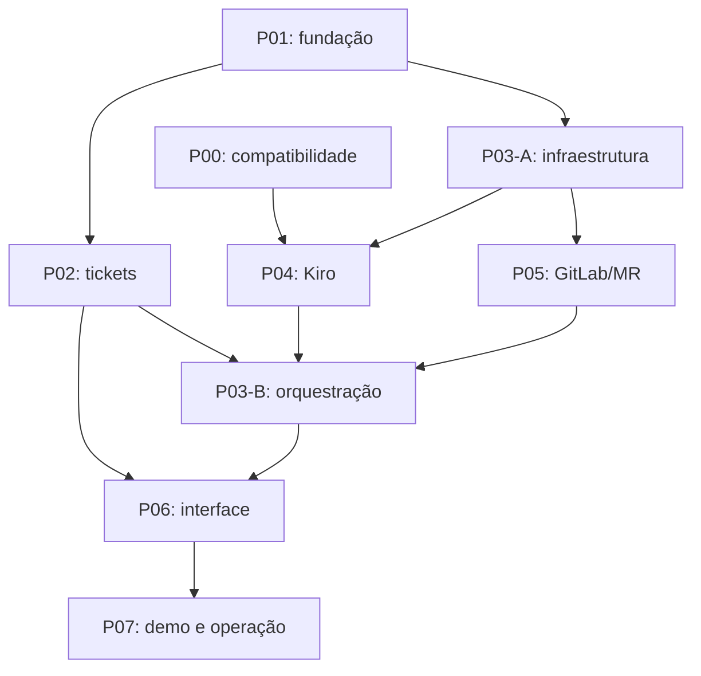

# Responsabilidades de entrega — proposta

Referências: [PRD](../PRD.md), [viabilidade](viabilidade.md), [tarefas 1–40](../tasks.md) e [rastreabilidade](rastreabilidade.md). Atribuições sugeridas a partir dos nomes do README; disponibilidade, experiência e concordância ainda não foram confirmadas. Nenhuma tarefa foi atribuída em serviço externo.

## 1. Frentes e entregas individuais

| Responsável | Frente principal proposta | Entrega verificável | Revisor/par proposto |
| --- | --- | --- | --- |
| SergioPacheco | Executor, arquitetura e integração | Reserva, testes vermelho/verde, supervisão e recuperação | Felipe/Amadeu |
| FelipeRamosOliveira | Fundação, PostgreSQL e tickets | Migrações, estados, versão otimista, API e testes | Sergio/Larissa |
| lucasspecht-sn | Kiro headless, contexto e relatórios | Pipeline CI, prompts, parser, callbacks e fixtures filtradas | Sergio/Amadeu |
| amadeujw | GitLab/MR e qualidade de integração | Disparo, publicação, checkpoints e reconciliação sem duplicação | Lucas/Sergio |
| larissasampaio-lcos | Interface e experiência do operador | Fluxos humanos, acompanhamento, erros e acessibilidade | Felipe/equipe |

Cada frente inclui código, testes e documentação. Nenhuma responsabilidade fica restrita a documentação não executável. Sergio integra, mas não concentra a autoria dos demais responsáveis nem todos os PRs.

## 2. Pacotes, esforço e correspondência

Pacotes são agrupamentos das tarefas existentes, sem criar outras specs para o mesmo MVP.

| Pacote | Tarefas atuais relacionadas | Dono proposto | Horas-base |
| --- | --- | --- | ---: |
| P00 Compatibilidade | Gate 0 adicionado ao plano | Lucas/Sergio | 16 |
| P01 Fundação/contratos e perfis | 1, 3, 4, 9 e 38 | Felipe | 32 |
| P02 Tickets/triagem/API/fila | 5, 6, 7, 8, 26 e tarefas 32–34 | Felipe | 52 |
| P03 Executor/orquestração | 2, parte execução de 6, 8, 10–13, 15–16, parte de 19/27–28 | Sergio | 56 |
| P04 Pipeline CI/Kiro e relatórios | 14, 29, 35 e 39 | Lucas | 44 |
| P05 GitLab/MR | 17–18, 40, parte de 19/27, fixtures GitLab de 29 | Amadeu | 36 |
| P06 Interface e fila | 20–24, tarefa 36 | Larissa | 48 |
| P07 QA/piloto/operação | 25, 30–31 e tarefa 37 | Equipe | 36 |
| **Subtotal** | Testes/revisão incluídos por frente | — | **320** |
| Reserva de integração/retrabalho | Não somar tarefas de teste novamente | Equipe | 75 |
| **Planejamento total** | Estimativa, sem horas realizadas | — | **395** |

As tarefas 26–29 atravessam as frentes; seu esforço já está nos pacotes que implementam o comportamento. As tarefas 38–40 acrescentam o vínculo da configuração ao ticket, o disparo da pipeline CI e a Merge Request ao planejamento; não contabilizá-las outra vez como uma fase extra de testes.

Distribuição de referência: Sergio 8 h P00 + 56 h P03 + 8 h P07 = 72; Felipe 32 h P01 + 52 h P02 = 84; Lucas 8 h P00 + 44 h P04 + 8 h P07 = 60; Amadeu 36 h P05 + 12 h P07 = 48; Larissa 48 h P06 + 8 h P07 = 56. Total 320 h.

Há concentração em Sergio. Após confirmar competências, transferir partes de testes/supervisor/orquestração aos pares; não atribuir toda a reserva ao integrador. Horas são estimativas de planejamento, não compromisso contratual nem medida de desempenho individual.

## 3. Dependências e trabalho simultâneo

P03-A entrega validação e contratos. P04 integra pipeline/Kiro. P05 integra GitLab/MR. P03-B coordena tickets, pipeline e callbacks. Essa divisão mantém a integração externa atrás de adaptadores simples.

UI pode avançar com contratos/fakes após P01/P02, mas só termina contra API real. Fixture do alvo pode ser preparada antes do fluxo integrado. Contratos e schema compartilhados têm dono coordenado: fazer PR pequeno de contrato antes de mudanças incompatíveis nos consumidores.

## 4. Marcos relativos

Hipótese: cinco pessoas × dez horas semanais × 75% de capacidade efetiva = 37,5 pessoas-hora/semana. `375 / 37,5 = 10 semanas`. É uma janela de planejamento, não prazo comercial garantido.

| Marco | Janela indicativa | Entrega e decisão |
| --- | --- | --- |
| M0 | Semana 1 | Ensaio P00 e definição do modelo operacional; prosseguir/replanejar |
| M1 | Semanas 2–3 | Tickets persistentes e executor base; revisar contratos/esforço |
| M2 | Semanas 4–5 | Adaptadores e integração por API; conferir vermelho/verde e SHA |
| M3 | Semanas 6–7 | Interface, ajustes e recuperação; fechar funcionalidades |
| M4 | Semanas 8–9 | Piloto, documentação, métricas de valor e operação comercial inicial |

Faltam prazo e capacidade reais. Se forem quatro semanas com essa disponibilidade, capacidade efetiva aproximada de 150 h não cobre a estimativa completa. Renegociar escopo em vez de prometer a mesma entrega com menos evidência.

## 5. Cards para organizar o trabalho

Quadro sugerido: `backlog`, `todo`, `doing`, `blocked`, `review`, `done`. GitHub Issues/Projects ou Trello podem materializar o quadro conforme regra atual. Nenhum quadro/issue foi criado nesta entrega.

| Card | Dono proposto | Escopo/aceite | Dependência |
| --- | --- | --- | --- |
| RES-PLAN Confirmar condições | Sergio | Requisitos operacionais, capacidade, prazo, custo e acesso registrados | Stakeholders do produto |
| RES-00 Provar integração | Lucas/Sergio | Gate 0 com evidências ou bloqueio explícito | Conta/alvo |
| RES-01 Subir fundação | Felipe | Tarefas 1/3/4/9; migração descartável e healthcheck | Contratos |
| RES-02 Operar tickets | Felipe | Tarefas 5/6-ticket/7; estados/versões/consulta | RES-01 |
| RES-02A Triar e encaminhar | Felipe/Lucas | Tarefas 5–8/32–35; cinco classificações, mensagem, fontes e elegibilidade | RES-01 |
| RES-03A Controlar processos/testes | Sergio | Tarefas 2/10–13/16; timeout, diff e teste congelado | RES-01/02A |
| RES-04 Integrar Kiro | Lucas | Tarefa 14; perfil/relatório/parser com testes | RES-00/03A |
| RES-05 Publicar/reconciliar PR | Amadeu | Tarefas 17–18; retorno perdido sem duplicação | RES-03A |
| RES-03B Orquestrar execução | Sergio | Tarefas 6-execução/8/15/19; reserva e sequência completas | RES-02/04/05 |
| RES-06A Construir telas de tickets | Larissa | Tarefas 20–22; ações e erros acessíveis | RES-01/02 |
| RES-06B Acompanhar execução | Larissa | Tarefas 23–24; cursor, lote final e PR confirmado | RES-03B |
| RES-07A Preparar alvo | Lucas | Tarefa 25; regra e baseline com bug deliberado | Contrato do piloto |
| RES-07B Ensaiar aceitação | Amadeu/equipe | Tarefa 31; requisitos ligados aos resultados reais | Fluxo integrado |
| RES-07C Documentar e preparar operação | Equipe/Larissa | Tarefa 30; operação executada, documentação e roteiro de adoção | Demo estável |

Cada card deve conter objetivo, escopo, arquivos, requisitos, critérios de aceite, dono/revisor, dependências, branch/PR e resultado observado. Copiar referência para a seção correspondente em `tasks.md`; não encerrar card só por existir plano escrito.

## 6. Fluxo Git e governança de entrega

- Base atual `main`; branches de tarefa pequenas como `feat/tickets-estados`, `feat/pipeline-kiro`, `feat/gitlab-mr`, `feat/interface-execucoes`. Não criar `develop` sem necessidade/regra confirmada.
- Commits convencionais em português, MR com comportamento, requisitos e validação. Revisão humana antes do merge, preservando histórico/branches conforme steering.
- Branches geradas pelo produto no alvo usam `resolva/...`; não confundir com branches de desenvolvimento do próprio Resolva.
- Código, testes e documentação devem ter autoria rastreável. Não fabricar commits, aprovação ou contribuição para mascarar lacunas de entrega.
- Cada responsável mantém links de cards, PRs, commits, testes e evidências próprios. Alterações em estrutura, escopo ou operação devem ser registradas na documentação canônica.

## 7. Definição de pronto por card

- [ ] Comportamento e casos de borda aceitos pela spec.
- [ ] Tipos, testes e verificações pertinentes executados com resultado registrado.
- [ ] Sem IA paga/PR real nos testes automatizados nem uso do banco da demonstração.
- [ ] Revisor verificou uma entrega concreta.
- [ ] Requisito, card, branch/PR e evidência individual relacionados.
- [ ] Pendências declaradas; ensaio autenticado separado dos fakes.

**Confiança: média.** Entregas e dependências são concretas; atribuições, capacidade, custos e validação de mercado permanecem pendentes.
