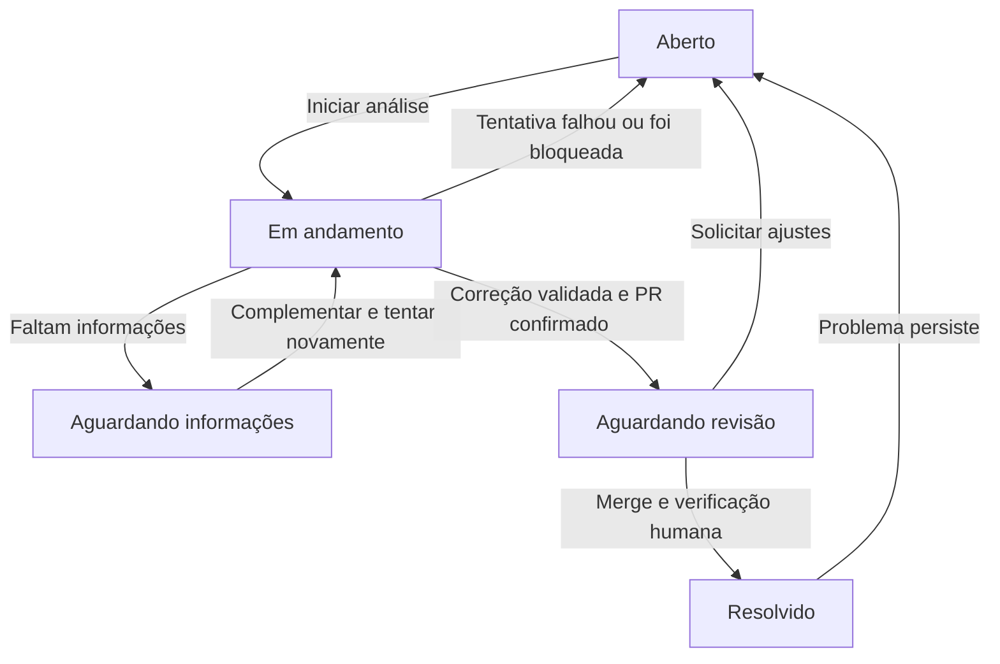

# Resolva — do ticket ao Pull Request com IA

Status: desenho em planejamento, com Kiro CLI headless, frontend e stack do Error Hub e PostgreSQL no Docker escolhidos pelo usuário. Este documento descreve o produto; a implementação ainda não começou.

## Contexto e objetivo

O Resolva é um projeto escolar: uma aplicação interna, configurada para um ambiente específico. O usuário cadastra um ticket na própria aplicação e inicia visualmente uma execução. A IA investiga um repositório real, modifica o código e a aplicação abre um Pull Request real no GitHub, acompanhado de diagnóstico e evidências de validação.

O objetivo da apresentação é demonstrar o caminho completo entre um problema relatado e uma correção revisável. Uma animação de etapas ou um PR simulado não satisfazem a entrega.

### Contexto acadêmico e repositório

- Grupo informado pelo usuário: **05**.
- Organização GitHub: [SENAI-IA](https://github.com/SENAI-IA).
- Turma e equipe confirmadas pela associação da conta GitHub à equipe: **IAPD-26T3**, **IAPD-26T3-E05** (`iapd-26t3-e05`).
- A convenção publicada pela organização utiliza `{turma}-e{nn}-{projeto}` para os repositórios das equipes, em minúsculas e com hífens. O nome definido para o Resolva é **`iapd-26t3-e05-resolva`**, na organização SENAI-IA.
- Destino do repositório solicitado: [SENAI-IA/iapd-26t3-e05-resolva](https://github.com/SENAI-IA/iapd-26t3-e05-resolva).
- O README do repositório deve apresentar objetivo, integrantes e instruções de execução. A organização orienta vincular a equipe correspondente ao repositório para permitir a colaboração dos integrantes.
- O repositório de materiais da turma é `SENAI-IA/iapd-26t3-materiais`. A atividade de kit do trabalho final dessa turma solicita README, requisitos EARS, regras em `AGENTS.md` e planejamento de skills, com entrega individual por PR dentro do repositório da equipe. O caráter individual ou coletivo da entrega do Resolva ainda deve ser alinhado à atividade correspondente; a criação do repositório da equipe não resolve essa distinção.

Fontes: [convenções da organização](https://github.com/SENAI-IA/.github/blob/main/profile/README.md) e [kit do trabalho final da turma IAPD-26T3](https://github.com/SENAI-IA/iapd-26t3-materiais/blob/main/2026-11-05-iapd-26t3-s03-aula-03-kit-do-trabalho-final-e-torneio/atividades/3.1-kit-do-trabalho-final/ficha.md).

## Requisitos confirmados

- Cadastro de tickets dentro do Resolva, sem depender de uma plataforma externa de chamados.
- Início manual do processamento pela interface.
- Acompanhamento visual do processo.
- Uso real de IA para investigar e alterar código.
- Kiro CLI sem interface (headless) como agente de programação, seguindo a abordagem identificada no Error Hub.
- Frontend do Error Hub como base visual e de componentes, adaptado ao domínio de tickets do Resolva.
- Mesma stack do Error Hub no frontend e no backend, com PostgreSQL executado no Docker.
- Uso de uma conta GitHub e de um projeto em andamento, que serão configurados posteriormente.
- Configuração para um ambiente específico, sem múltiplas empresas.
- Escopo inicial limitado a um módulo conhecido e categorias previamente definidas.
- Validação em ambiente de teste e entrega de um PR para revisão humana.
- Registro de impedimentos quando não houver informação ou evidência suficiente.
- Merge e alterações em produção realizados pelo time.
- Ciclo de vida do ticket com histórico de execuções, complementação de informações, revisão humana e encerramento manual após verificação da correção.

## Abordagens consideradas

1. **Painel próprio e processamento no backend.** Permite cadastrar tickets, disparar execuções e acompanhar evidências no mesmo lugar. É a direção coerente com a solicitação de cadastro e disparo visual. Para o projeto escolar, interface e executor pertencem à mesma aplicação; o executor roda fora do ciclo de uma requisição HTTP.
2. **Automação em uma plataforma externa de tickets.** Reduz a interface a construir, mas não atende tão bem à demonstração solicitada e exige outra ferramenta. Fica fora do MVP.
3. **Protótipo visual com resultados simulados.** Facilita a apresentação, mas não atende ao requisito confirmado de alterar código e criar um PR real. Descartado.

A proposta abaixo concretiza a primeira abordagem. As decisões ainda não confirmadas estão identificadas como propostas.

Para o motor de correção, foram consideradas a construção de um ciclo próprio de ferramentas via API e a utilização de um agente de programação existente. Após a análise do Error Hub, o usuário escolheu o **Kiro CLI headless**. O Resolva cuidará da orquestração e utilizará as ferramentas de programação do Kiro, sem implementar um agente próprio do zero. A execução local no backend é a proposta para o MVP; uma pipeline remota, como a do Error Hub, continua sendo uma evolução possível.

## Limites do MVP — proposta

- Uma instalação local para demonstração, utilizada por um operador de cada vez.
- Um único repositório GitHub alvo, uma branch base e um módulo permitido por configuração.
- Uma execução ativa por vez; a interface informa quando há outra em andamento.
- Tickets de correção de bugs pequenos, com comportamento esperado verificável por teste.
- Categorias iniciais propostas: validação de entrada, regra de negócio simples e cálculo incorreto. O conjunto final depende do projeto alvo.
- Uma integração com o Kiro CLI headless e uma integração com o GitHub. Não é necessário um segundo serviço de IA para triagem ou redação de tickets no MVP.
- Sem login, gestão de usuários, webhooks, deploy automático ou infraestrutura distribuída nesta primeira entrega local.
- Correção de dados, consultas a bancos de negócio e execução de scripts de dados ficam para uma etapa posterior. Esses tickets são registrados como fora do escopo.

O repositório alvo pode ser um projeto do grupo. Recomenda-se mantê-lo separado do repositório do Resolva durante a demonstração, para que o executor não altere a aplicação que o está executando. Essa separação é uma proposta, não uma exigência já aprovada.

## Experiência do usuário — proposta

### Base visual escolhida: Error Hub

Reutilizar a base React/TypeScript do Error Hub, com Vite, Tailwind CSS, TanStack Router, TanStack Query, componentes Radix e ícones Lucide conforme necessário. A referência visual principal é o CSS realmente aplicado em `error-hub/web/src/index.css`, complementado por `error-hub/docs/DESIGN.md`.

Manter o tema escuro, a paleta azul, tipografia, espaçamento, tabelas, formulários, estados de carregamento, confirmações e mensagens. Adaptar a identidade para Resolva e a navegação para **Tickets**, **Execuções** e **Configuração**. O cadastro do ticket é uma ação dentro de Tickets. A entrega do PR aparece na execução correspondente, sem exigir uma seção separada.

O reaproveitamento é feito por seleção dos arquivos e adaptação das telas. As rotas originais dependem dos tipos do backend do Error Hub via `backend/router`, de autenticação Google, telemetria, filtros por ambiente e integrações Azure DevOps/GitLab. Copiar integralmente `web/` não produz um frontend independente e executável para o Resolva.

Mapeamento da reutilização:

| Origem no Error Hub | Aplicação no Resolva |
| --- | --- |
| `web/src/index.css` e fontes de `web/index.html` | Tokens, tema e tipografia de base |
| `components/layout/AppShell.tsx`, `Sidebar.tsx`, `TopBar.tsx` | Estrutura da aplicação, com marca, menus e cabeçalho adaptados |
| `components/ui/` | Botões, campos, tabelas, paginação, badges, confirmações, estados vazios e carregamento; copiar apenas os componentes utilizados |
| `routes/_protected/agent/runs/index.tsx` | Histórico de execuções por ticket, com estados e filtros do Resolva |
| `routes/_protected/agent/runs/$runId.tsx` | Acompanhamento de etapas reais, diagnóstico, testes, logs e link do PR |
| `routes/_protected/agent/$errorId.tsx` | Referência para o disparo manual; integrar a ação ao detalhe do ticket |
| `trpc.ts` e providers de dados | Substituir os contratos do Error Hub pelos endpoints do Resolva; manter TanStack Query para consultas e atualização periódica |

As telas de listagem, cadastro e detalhes de tickets devem ser construídas com os componentes reutilizados. Os tickets do Error Hub são vinculados a erros e ao Azure DevOps, portanto não atendem diretamente ao cadastro local solicitado. O MVP local permanece sem login: componentes de sessão e proteção de rotas são adaptados para esse escopo.

O plano técnico deve incluir a verificação das dependências dos componentes copiados, dos tokens CSS utilizados e do layout nos tamanhos da demonstração. A documentação visual não deve ser tomada como prova de que todos os comportamentos responsivos já estejam implementados.

### Tickets

Lista com identificador, título, categoria, status e última execução. Ações principais: cadastrar ticket, abrir detalhes e iniciar análise.

O formulário contém título, descrição, comportamento esperado, passos para reproduzir e categoria. Título, descrição, comportamento esperado e categoria são obrigatórios. Regras de preenchimento são verificadas no backend.

### Detalhes e execução

Exibe quatro blocos: **relato**, **status e próxima ação**, **histórico de execuções** e **PR vinculado**. O botão **Iniciar análise** fica disponível conforme o estado do ticket. Após o disparo, mostra a etapa atual, eventos com horário e resultados produzidos. O processamento continua se a página for fechada; reabri-la recupera os dados persistidos.

Etapas apresentadas:

1. **Preparando ambiente:** verificar configuração, obter código e documentação e executar a validação inicial.
2. **Analisando o ticket:** interpretar o problema, verificar o escopo e investigar código, regras documentadas e testes relevantes.
3. **Reproduzindo o problema:** criar o teste de regressão e comprovar a falha antes da correção.
4. **Implementando a correção:** aplicar a mudança sustentada pelo diagnóstico.
5. **Validando:** executar os comandos configurados e avaliar seus resultados.
6. **Publicando o PR:** criar commit, publicar branch e abrir ou atualizar o PR no GitHub.

O resultado apresenta diagnóstico com referências a arquivos, resumo das mudanças, testes executados, branch, commit e link do PR. A interface só mostra o link depois de a integração confirmar a existência do PR.

Em caso de impedimento, apresenta o motivo, o que foi investigado e a informação necessária para continuar. O usuário pode complementar o ticket e iniciar uma nova tentativa, preservando o histórico da anterior.

### Configuração do ambiente

Uma tela mostra o projeto alvo, branch base, módulo permitido, categorias, fontes de documentação, comandos de validação e disponibilidade das integrações.

No MVP, a configuração é carregada no servidor, por arquivo local e variáveis de ambiente. Não é necessário construir um editor de configuração. Tokens e chaves não são exibidos nem enviados ao navegador.

## Estrutura técnica — proposta

- **Interface web:** React/TypeScript, aproveitando frontend e componentes do Error Hub para cadastro, listagem, detalhes, execução e configuração visível.
- **Backend:** Node.js/TypeScript com Fastify, tRPC e Zod; valida os tickets, persiste os dados, controla as transições e fornece o progresso à interface.
- **Executor:** rotina em segundo plano, iniciada pelo backend, que conduz uma execução por vez, chama o Kiro como subprocesso, executa as validações e coordena a entrega. Não exige um serviço separado ou fila externa.
- **Persistência:** PostgreSQL em um container Docker, acessado com Drizzle ORM e o driver `postgres`. Tickets, execuções, eventos e referências às evidências ficam no banco. Cópias de trabalho e evidências maiores usam diretórios próprios no host, referenciados pelas execuções.
- **Adaptador Kiro:** prepara as instruções e o contexto, inicia o CLI na cópia de trabalho da execução e captura eventos, saída de diagnóstico e código de saída. Leitura, busca e edição são realizadas pelas ferramentas do próprio Kiro, com uma política de permissões gerenciada pelo Resolva.
- **Integração Git/GitHub:** obtém o repositório, cria a branch, publica alterações e abre ou recupera o PR correspondente.

O frontend e o backend seguirão a stack do Error Hub. Os contratos tRPC serão definidos para o domínio do Resolva, aproveitando os padrões existentes sem importar as funcionalidades de monitoramento de erros. O agente de programação já está escolhido: Kiro CLI. A versão do CLI, o motor e o modelo devem ser registrados na configuração da execução. A entrega real exige autenticação válida para o modo headless do Kiro e permissão de escrita no repositório GitHub; a conta do GitHub não substitui o acesso ao Kiro.

A interface pode consultar periodicamente o backend para atualizar o andamento. Streaming de tokens e infraestrutura de mensagens não são necessários para a primeira versão.

### Stack definida

As versões abaixo representam a base identificada nos arquivos do Error Hub, adotada como referência para a implementação. As versões efetivamente instaladas serão registradas no lockfile do Resolva.

| Camada | Escolha |
| --- | --- |
| Organização | Monorepo com pacotes `web` e `backend`, usando pnpm 10 |
| Linguagem | TypeScript 6 com tipagem estrita |
| Frontend | React 19 e Vite 8 |
| Estilos e componentes | Tailwind CSS 4, Radix UI e Lucide |
| Rotas e dados | TanStack Router, TanStack Query e Zustand para estado compartilhado quando necessário |
| Backend | Node.js 22 e Fastify 5 |
| Contratos da API | tRPC 11 com tipos compartilhados entre frontend e backend |
| Validação | Zod 4 |
| Banco | PostgreSQL 17 em container Docker |
| Acesso ao banco e migrações | Drizzle ORM, Drizzle Kit e driver `postgres` |
| Logs | Pino |
| Testes | Vitest e Testcontainers para testes de integração com PostgreSQL |
| Lint e formatação | Oxlint e Oxfmt |
| Agente de programação | Kiro CLI headless |
| Entrega de correções | Git e integração com o GitHub para branches, commits e PRs |

Toad Scheduler, utilizado no Error Hub, fica disponível como referência para tarefas periódicas se surgirem necessidades concretas. O disparo manual das execuções usa a rotina em segundo plano já descrita, sem exigir agendamento periódico. A escolha da mesma stack não adiciona autenticação Google, Azure DevOps, GitLab CI ou monitoramento de erros ao escopo do Resolva. Nginx e containers para a aplicação podem ser acrescentados posteriormente; para o desenvolvimento inicial, o banco roda no Docker e frontend, backend e Kiro rodam no host.

### PostgreSQL no Docker

- Criar um `docker-compose.yml` do Resolva com serviço `postgres` e volume nomeado próprio para persistir os dados entre reinicializações do container.
- Usar banco e usuário locais identificados como `resolva`, sem reutilizar o banco do Error Hub.
- Carregar usuário, senha e porta por variáveis de ambiente; documentar valores de desenvolvimento em `.env.example` e manter credenciais reais fora do versionamento.
- Como proposta de configuração local, publicar a porta do banco em `127.0.0.1:5433`, configurável por `POSTGRES_PORT`. Isso permite manter o padrão `5432` do Error Hub separado. Dentro do container, o PostgreSQL continua usando a porta `5432`.
- Configurar `DATABASE_URL` no backend para acessar o PostgreSQL exposto no host. A credencial do banco pertence ao backend e não ao frontend ou ao contexto do Kiro.
- Incluir uma verificação de saúde no serviço do banco. Executar as migrações Drizzle antes de iniciar o atendimento da API e reportar erros de conexão ou migração com clareza.
- A rotina de desenvolvimento será: iniciar o banco com Docker Compose, aplicar migrações e iniciar os pacotes `backend` e `web` no host. Os comandos exatos serão definidos no plano de implementação.
- Usar um PostgreSQL descartável via Testcontainers nos testes de integração. Os testes não devem apagar ou recriar o banco utilizado na demonstração.

### Integração headless verificada

Em 2026-11-05, o ambiente de planejamento possui `kiro-cli 3.0.0`. Foram executados apenas `kiro-cli --version` e `kiro-cli chat --help`, sem iniciar uma sessão de IA ou testar autenticação.

A documentação oficial descreve execução não interativa com `--no-interactive`, instruções por argumento ou stdin, saída em JSON Lines com `--output-format stream-json` e autenticação headless por `KIRO_API_KEY`. Também recomenda escolher explicitamente o motor, pois os padrões variam por modo de execução.

Forma prevista de invocação para o MVP, a validar com o projeto de demonstração:

```text
kiro-cli chat --v3 --no-interactive --output-format stream-json
```

O backend enviará a instrução por stdin e definirá o diretório de trabalho da cópia clonada. A linha acima é a base do comando, não uma configuração completa de permissões. Modelo, agente e permissões serão acrescentados por argumentos e configuração gerenciados; o texto do ticket não será interpolado em uma linha de shell.

As permissões necessárias de leitura e edição devem ser pré-configuradas para que uma execução não dependa de confirmação em terminal. Um pedido de aprovação não atendido é registrado como impedimento ou falha de configuração. O plano deve verificar as permissões efetivas na versão instalada; não deve presumir que passar um prompt restringe as ferramentas.

Fontes: [modo headless](https://kiro.dev/docs/cli/headless/) e [seleção do motor](https://kiro.dev/docs/cli/agent-harness/).

## Configuração necessária antes da execução real

- Docker com Compose disponível, banco PostgreSQL iniciado e `DATABASE_URL` configurada no backend.
- URL do repositório GitHub e branch base.
- Caminhos permitidos para alterações, incluindo código, testes e documentação pertinente ao módulo.
- Caminhos de documentação e regras de negócio dentro do repositório ou de uma pasta local preparada pelo operador.
- Comandos de preparação e validação, definidos pelo operador para o projeto alvo.
- Credencial GitHub com permissão para publicar branches e abrir PRs, além da identidade dos commits.
- Caminho e versão suportada do Kiro CLI, motor, modelo e perfil de agente/permissões.
- Credencial headless do Kiro, separada da credencial GitHub.
- Limites de tempo, iterações e tamanho das alterações.

O primeiro cenário demonstrável deve usar um bug conhecido, um resultado esperado documentado e um teste executável. O cadastro de tickets pode ser demonstrado antes de essas integrações estarem disponíveis, mas a funcionalidade ticket → PR só estará validada após uma execução real.

## Contrato do executor

1. Receber o identificador do ticket. Criar uma execução persistida vinculada a uma cópia do relato e da configuração, sem armazenar segredos nessa cópia.
2. Verificar escopo, credenciais disponíveis e exclusividade de execução. Criar uma cópia de trabalho própria e registrar o commit inicial. Na primeira correção, partir da branch base; em ajustes de um PR aberto, partir da branch daquele PR, preservando as mudanças existentes.
3. Executar a preparação e os testes configurados antes de alterar arquivos. Se o ambiente não puder executar os testes ou eles já falharem, registrar o impedimento e encerrar a tentativa.
4. Invocar o Kiro headless com o ticket, os limites de atuação e as referências locais de documentação. O Kiro consulta código, documentação e testes pelas ferramentas permitidas, sem presumir que todo o repositório cabe numa única solicitação. O backend captura o processo e seus eventos reais.
5. Solicitar ao Kiro um diagnóstico sustentado por referências ao código ou à documentação. Quando o comportamento esperado for ambíguo ou contrariar as regras disponíveis, registrar a necessidade de análise humana e não prosseguir para publicação.
6. Solicitar ao Kiro a criação ou alteração do teste de regressão em uma fase própria. O backend executa a validação e registra a falha correspondente ao comportamento relatado. Só então solicita ao Kiro a correção e executa novamente a validação. Cada fase fornece o contexto e os artefatos necessários, sem depender de uma conversa interativa.
7. Permitir até três rodadas de correção por execução por padrão, respeitando os limites de tempo. Em caso de falha, enviar ao Kiro os resultados reais dos testes para a rodada seguinte. Sem validação bem-sucedida, encerrar com impedimento e preservar as evidências. Essas rodadas pertencem à mesma execução.
8. Conferir o diff, impedir alterações fora dos caminhos permitidos e recusar um resultado sem mudanças. O backend decide se as condições para abrir o PR foram cumpridas.
9. Criar commit e publicar uma branch identificada pelo ticket e pela primeira execução daquela entrega. Abrir um PR para a branch base configurada. Se o ticket já tiver um PR aberto e estiver em uma execução explícita de ajuste, publicar na mesma branch e atualizar o PR existente.
10. Persistir URL do PR, commit, diagnóstico e evidências. O sucesso depende da confirmação do GitHub.

O Resolva executa os comandos de preparação, teste e publicação definidos na configuração. O perfil do Kiro deve permitir as ferramentas de leitura e edição necessárias e restringir execução de shell; testes e operações Git/GitHub ficam sob controle do executor. O ticket e o modelo não podem introduzir comandos de shell arbitrários. Alterações em configuração de CI, credenciais e arquivos fora do módulo permitido não fazem parte do MVP.

O término bem-sucedido do processo Kiro não basta para marcar a execução como concluída. O backend confere alterações e resultados de testes, cria o commit, publica a branch e confirma o PR. O Kiro não recebe a credencial de publicação no GitHub. Fases de entendimento, criação do teste e correção são invocações controladas pelo executor; etapas da interface avançam por essas ações e pelas validações, sem inferir sucesso de frases livres do agente.

Uma cópia de trabalho separada evita misturar alterações, mas não é uma barreira de segurança do sistema operacional. O MVP executa apenas o projeto de demonstração confiável, em ambiente local de testes sem acesso a produção. Uma sandbox de execução mais forte seria uma evolução posterior.

Tokens permanecem sob controle do backend e não entram no contexto da IA. Arquivos de segredos são excluídos da leitura e da publicação; evidências apresentadas na interface passam por remoção dos valores secretos configurados. Não se pretende detectar qualquer segredo desconhecido automaticamente.

## Estados e histórico

O **ticket representa o problema relatado**. Uma **execução representa uma tentativa da IA de investigar e entregar uma correção**. Um ticket pode ter várias execuções, todas preservadas no histórico. As rodadas automáticas de correção dentro de uma execução não criam novos tickets ou novas execuções.

### Ciclo de vida do ticket



| Estado | Identificador | Significado | Ação principal |
| --- | --- | --- | --- |
| Aberto | `aberto` | Ticket cadastrado, reaberto ou disponível para nova tentativa após impedimento. | Iniciar análise, quando as condições de execução forem atendidas |
| Em andamento | `em_andamento` | Existe uma execução ativa para o ticket. | Acompanhar execução |
| Aguardando informações | `aguardando_informacoes` | A investigação precisa de esclarecimentos do usuário. | Complementar o ticket e iniciar nova tentativa |
| Aguardando revisão | `aguardando_revisao` | Existe um PR com a correção validada, aguardando avaliação humana. | Abrir PR, registrar ajustes ou confirmar resolução |
| Resolvido | `resolvido` | O operador confirmou o merge e a verificação da correção no ambiente de teste. | Consultar histórico ou reabrir com justificativa |

### Do cadastro à revisão

1. **Cadastrar:** o usuário informa título, descrição, comportamento esperado, passos para reproduzir e categoria. Pode adicionar mensagens de erro e observações. O Resolva gera um identificador, como `RES-001`, e salva o ticket como **Aberto**.
2. **Iniciar:** ao clicar em **Iniciar análise**, o backend verifica as condições de execução, registra uma cópia do ticket e da configuração e marca o ticket como **Em andamento**. Edições posteriores não alteram o contexto de uma execução já iniciada.
3. **Preparar:** o backend verifica integrações, cria a cópia de trabalho e executa os testes iniciais. A interface mostra repositório, branch e resultado inicial.
4. **Analisar:** o Kiro interpreta o relato e investiga código, documentação e regras. A interface apresenta o entendimento e o diagnóstico com referências verificáveis.
5. **Reproduzir:** o Kiro cria o teste de regressão e o backend executa a validação, registrando a falha correspondente ao problema antes da correção.
6. **Corrigir:** o Kiro modifica o código relacionado ao diagnóstico. A interface mostra os arquivos envolvidos e o resumo da mudança.
7. **Validar:** o backend confere o diff e executa os testes. Se falharem, envia os resultados reais ao Kiro, respeitando o limite de três rodadas por execução. Os comandos, resultados e motivos de falha ficam registrados.
8. **Publicar:** após a validação, o backend faz commit, publica a branch e abre ou atualiza o PR. O ticket passa para **Aguardando revisão** somente depois da confirmação do GitHub.
9. **Revisar e resolver:** o time revisa o PR no GitHub, realiza o merge e verifica a correção no ambiente de teste. Depois, o operador usa **Marcar como resolvido** no Resolva. O encerramento é manual no MVP; não há necessidade de webhooks ou monitoramento automático do merge.

O PR apresenta relato, comportamento esperado, diagnóstico, alterações, evidências dos testes e identificação do ticket. A execução pode estar concluída e o ticket continuar aguardando revisão. A abertura do PR não representa resolução em produção.

### Impedimentos e novas tentativas

- **Informação insuficiente:** a execução termina como `bloqueada` e o ticket passa para **Aguardando informações**. A interface deve solicitar algo concreto, por exemplo: “Qual desconto deveria ser aplicado quando o cliente possui duas promoções?”. Depois da complementação, uma ação explícita inicia outra execução vinculada à anterior.
- **Falha técnica:** problemas como autenticação inválida ou indisponibilidade do Kiro encerram a execução como `falhou`. O ticket volta para **Aberto**, exibindo o motivo e permitindo nova tentativa após a configuração ou o serviço ser restabelecido.
- **Validação sem sucesso ou correção não sustentada:** após o limite de rodadas, a execução termina como `bloqueada`, o ticket volta para **Aberto** e apresenta as evidências e a necessidade de análise humana. Nenhum novo PR é criado e nenhuma alteração não validada é publicada em um PR existente.
- **Fora do escopo:** a execução registra `bloqueada` e mantém o ticket **Aberto** com o impedimento. A repetição só faz sentido depois de ajustar o escopo/configuração ou encaminhar o ticket para tratamento humano.
- **Servidor interrompido:** na próxima inicialização, a execução fica como `interrompida` e o ticket volta para **Aberto**, com indicação da interrupção. Não há retomada automática de comandos.

### Ajustes na revisão e reabertura

Quando o revisor solicitar alterações, o operador registra as observações no Resolva pela ação **Solicitar ajustes**. O ticket volta para **Aberto**. Uma nova execução usa essas observações e a branch do PR existente como contexto, preserva o histórico anterior e atualiza o mesmo PR enquanto ele estiver aberto. A execução anterior continua concluída; ela não é reescrita como falha.

Antes de repetir uma publicação ou atualizar uma correção, o backend consulta a existência e o estado do PR vinculado. Se o PR estiver fechado sem merge, apresenta o impedimento para decisão humana. Se já tiver sido integrado e o problema persistir, o operador reabre o ticket com justificativa; a próxima entrega parte novamente da branch base e cria outra branch e outro PR, mantendo os vínculos anteriores no histórico.

No MVP, observações de revisão e confirmação da resolução são registradas manualmente no Resolva. Comentários ou eventos do GitHub não mudam automaticamente o estado do ticket.

### Estados da execução e rastreabilidade

- Execução: `em_andamento`, `bloqueada`, `falhou`, `concluida`, `interrompida`.
- Etapa: `preparando_ambiente`, `analisando_ticket`, `reproduzindo_problema`, `implementando_correcao`, `validando`, `publicando_pr`.

`bloqueada` representa uma limitação de escopo, falta de informação ou impossibilidade de validar com evidência. `falhou` representa um erro técnico, como falha de autenticação do Kiro, término inesperado do processo ou indisponibilidade do GitHub. Uma execução concluída possui um PR confirmado.

Cada execução registra a versão do ticket usada, configuração sem segredos, commit inicial, versão/motor/modelo do Kiro, horários, etapas, rodadas de correção, eventos, diagnóstico, arquivos alterados, comandos e códigos de saída, evidências, branch, commit final e URL do PR, quando existir. Uma nova tentativa registra o vínculo com a execução anterior e as observações que a motivaram. O histórico do ticket também registra mudanças de estado, pedidos de informação, respostas, ajustes solicitados, resolução e reabertura. Não é necessário guardar raciocínio interno do modelo: a aplicação registra conclusões e ações verificáveis. Logs são filtrados antes de serem expostos na interface.

As ações de iniciar e repetir são protegidas contra clique duplicado e respeitam o limite global de uma execução ativa. Uma execução bem-sucedida não pode ser reiniciada pelo botão original; ajustes exigem a ação explícita descrita acima. Nenhuma nova tentativa apaga uma execução anterior.

Antes de repetir a publicação, a aplicação verifica se a branch ou o PR da tentativa anterior já existe; o histórico permite recuperar seu link sem abrir um PR duplicado. A publicação em uma branch existente deve preservar alterações anteriores e parar diante de conflitos ou mudanças concorrentes que não possam ser conciliadas com segurança.

## Conteúdo do Pull Request

- Título com identificador e resumo do ticket.
- Identificação do ticket no Resolva e cópia resumida do relato e do comportamento esperado. Incluir link navegável quando a instalação estiver acessível ao revisor.
- Diagnóstico e referências aos arquivos ou regras consultados.
- Resumo da correção e do teste de regressão.
- Comandos executados, resultado inicial e resultado após a correção.
- Limitações ou observações relevantes para o revisor.

Um PR aberto não significa que o ticket foi resolvido em produção. O MVP acompanha a entrega para revisão e permite o encerramento manual do ticket após o operador confirmar o merge e a verificação no ambiente de teste; não precisa monitorar merge ou implantação automaticamente.

## Critérios de aceitação

1. Cadastrar um ticket pela interface e recuperá-lo após reiniciar a aplicação.
2. Iniciar o processamento visualmente e acompanhar eventos reais, persistidos e recuperáveis ao reabrir a página.
3. Rejeitar disparos duplicados e informar a existência de outra execução ativa.
4. Em um repositório real configurado, reproduzir um bug com teste, aplicar uma correção real e executar a validação com sucesso.
5. Abrir um único PR por entrega no GitHub com o diff, o teste de regressão e as evidências vinculados ao ticket. Execuções de ajuste atualizam esse PR enquanto estiver aberto.
6. Diante de relato insuficiente, categoria não permitida, falha de validação ou ausência de uma correção sustentada, apresentar um impedimento e não abrir PR.
7. Apresentar erros de integração sem inventar resultados e permitir uma nova tentativa rastreável.
8. Não efetuar merge, deploy nem alterações em dados de produção.
9. Percorrer os estados do ticket, distinguindo execução concluída, revisão pendente e resolução confirmada manualmente.
10. Complementar um ticket com informação insuficiente, iniciar nova execução e preservar o contexto e as evidências da anterior.
11. Registrar ajustes pedidos pelo revisor e atualizar o PR aberto sem duplicá-lo.
12. Marcar um ticket como resolvido após confirmação humana de merge e verificação em teste, e permitir sua reabertura com justificativa.
13. Persistir tickets, execuções e histórico no PostgreSQL em Docker e recuperá-los após reiniciar o backend e o container do banco, mantendo o volume.

## Demonstração escolar

Preparar um repositório com um módulo pequeno, documentação da regra e testes inicialmente aprovados, mas contendo um bug que ainda não tenha cobertura. Cadastrar um relato claro no Resolva, iniciar o processo e mostrar as evidências de cada etapa. Ao final, abrir o GitHub e conferir o PR, o diff e o teste incluído.

Preparar também um ticket com informação insuficiente para demonstrar o encaminhamento à análise humana. A duração varia conforme o provedor e o projeto; a interface deve mostrar o progresso real, sem prometer um prazo fixo.

Demonstrar a complementação desse ticket e a preservação da primeira execução. No cenário de sucesso, mostrar o ticket aguardando revisão após o PR e, depois da revisão, merge e verificação em teste realizados pelo grupo, registrar manualmente a resolução. Se houver pedido de ajustes, demonstrar a atualização do mesmo PR por uma execução posterior.

## Decisões propostas para aprovação

- Kiro CLI headless como agente de programação: escolha já confirmada pelo usuário. A implementação das demais decisões abaixo permanece proposta.
- Frontend do Error Hub como base de layout, estilo e componentes, com adaptação para tickets locais, execuções e PRs no GitHub.
- Mesma stack do Error Hub: Node.js/TypeScript, Fastify, tRPC, Drizzle e PostgreSQL em Docker, além da base React já definida. Escolha confirmada pelo usuário.
- Aplicação única com interface e executor em segundo plano, uma execução por vez.
- Instalação local sem login no MVP escolar.
- Um repositório alvo, de preferência separado do Resolva, com um módulo permitido.
- Configuração local no servidor; tela de consulta, sem editor de credenciais.
- Correções de código com teste de regressão; correções de dados adiadas.
- Critério de sucesso: PR real confirmado, com mudanças e validação rastreáveis.

Com a stack definida, o próximo artefato será o plano de implementação, com estrutura de arquivos, modelo de dados, contratos tRPC, integração Kiro/GitHub, etapas e verificações. A execução real depende da configuração posterior do repositório e das credenciais Kiro/GitHub.
